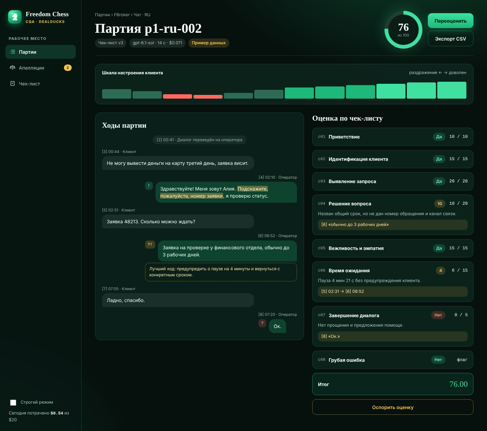
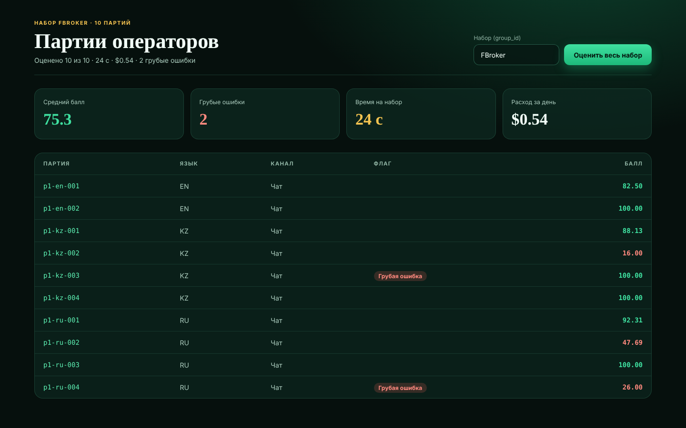

# Freedom Chess — изумрудный дизайн (макет)

Концепт оформления интерфейса CQA в стиле «изумрудные шахматы». Это **статический макет**, код приложения в `static/` не изменён.

| Экран | Файл | Превью |
|---|---|---|
| Разбор диалога | [review.html](review.html) |  |
| Список партий | [list.html](list.html) |  |

- Список партий — реальные итоги контрольного набора FBroker (`results/prod/results.json`).
- Разбор диалога — **пример данных** для показа оформления: транскрипт и баллы условные.
- Палитра: фон #06100D, поверхности #0E2A21, изумруд #3FE0A0 / #1DB97A, золото #F5C451, ошибка #FF6B5E. Шрифты: Playfair Display (заголовки), Manrope (текст), JetBrains Mono (цифры).
